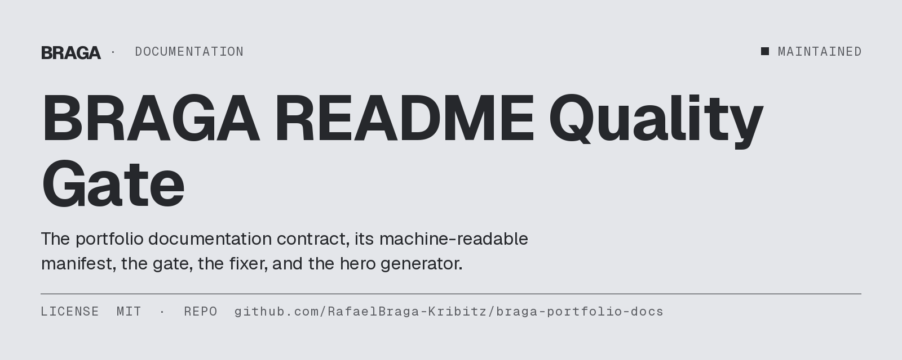
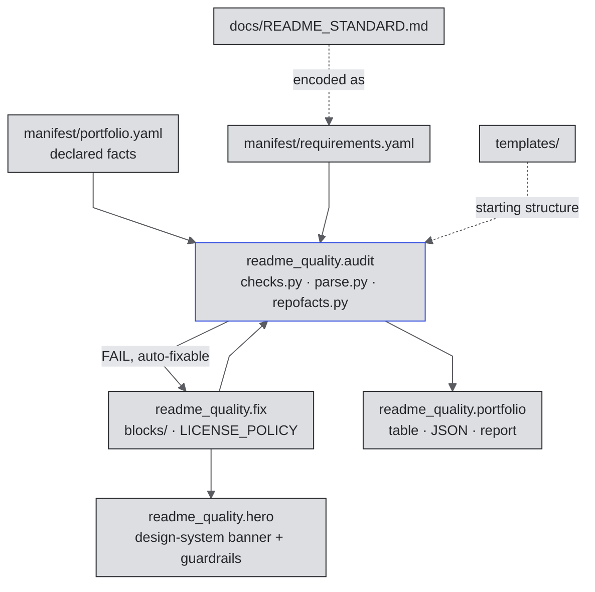

# BRAGA README Quality Gate



[](https://github.com/RafaelBraga-Kribitz/braga-portfolio-docs/actions/workflows/readme-quality.yml)
[](requirements.txt)
[](LICENSE)
[](#status)

**Status:** Maintained

The portfolio owner decides which standard every public BRAGA repository must meet. A portfolio of thirteen public repositories drifts into thirteen README styles, and a visitor cannot tell a well-documented project from a well-formatted one. This repository holds the one contract every public BRAGA project must meet, and the tooling that checks, fixes, and illustrates it.

## What it does

The standard says what "great" means for a README of a given project type. A machine-readable manifest turns that into stable requirement ids with severities and remediation rules. The gate audits a checkout against the manifest and returns `PASS`, `PASS_WITH_EXCELLENCE`, `FAIL`, or `BLOCKED_HUMAN` per requirement, without ever scoring prose. The fixer applies only remediations that can be derived from repository facts or the registry: badges, status lines, license files under a written policy, the canonical author block, a factual repository tree, broken-path repair, and a design-system hero banner rendered with layout guardrails. Everything that needs judgement stays with an agent or a human, guided by the templates and the agent guide.

```text
Standard  docs/README_STANDARD.md      what "great" means, per project type
Manifest  manifest/requirements.yaml   58 requirement ids, severity, check, remediation, escalation (v1.5.0)
Registry  manifest/portfolio.yaml      declared type, status, hero, demo, license, diagram facts per project
Gate      readme_quality.audit         PASS / PASS_WITH_EXCELLENCE / NOT_APPLICABLE / WARN / FAIL / BLOCKED_HUMAN
Fixer     readme_quality.fix           safe remediation from evidence only
Generator readme_quality.hero          design-system v2.1 banner (D-051) with programmatic guardrails
Diagram   readme_quality.diagram       gitdiagram graph -> design system; click targets verified
Blocks    blocks/                      canonical author, license, status, legend, audience, structure blocks
Templates templates/                   analytical, library, framework, interactive, foundation
```

## Explore this project

| Audience | Start here |
|---|---|
| Fast path | [The standard](docs/README_STANDARD.md) · [Quick start](#quick-start) |
| Coding agents | [Agent guide](docs/AGENT_GUIDE.md) · [`CLAUDE.md`](CLAUDE.md) |
| Technical reviewer | [Architecture](#architecture) · [`readme_quality/checks.py`](readme_quality/checks.py) · [Tests](tests/) |
| Portfolio owner | [License policy](docs/LICENSE_POLICY.md) · [Architecture diagrams](docs/ARCHITECTURE_DIAGRAMS.md) · [Latest portfolio run](docs/readme-audit-latest.md) |

## Quick start

```bash
git clone https://github.com/RafaelBraga-Kribitz/braga-portfolio-docs.git
cd braga-portfolio-docs
pip install -r requirements.txt

python -m readme_quality audit --repo ../some-project --verbose   # one checkout
python -m readme_quality fix   --repo ../some-project             # safe fixes, then re-audit
python -m readme_quality explain identity.hero                    # what a requirement id means
python -m readme_quality diagram --name dsx --input raw.mmd --accent node_audit_cli   # restyle a gitdiagram graph
BRAGA_REPOS_ROOT=.. python -m readme_quality portfolio             # every registered repository
make test                                                          # the gate's own tests
```

`make readme-audit`, `make readme-fix`, `make readme-hero REPO=…`, and `make readme-check` wrap the same commands. The design system comes from `tokens.json` and the BKribitz faces of [braga-portfolio-v2](https://github.com/RafaelBraga-Kribitz/braga-portfolio-v2/tree/main/design-system) (v2.1): a sibling checkout or `BRAGA_DS` wins, otherwise the snapshot vendored in `readme_quality/design/` (SIL OFL 1.1, licence alongside) is used; `make design-sync` refreshes it, and a test fails while it has drifted from a sibling checkout.

## What it enforces

| Family | Requirement ids | Gate effect |
|---|---|---|
| Identity | `identity.h1` `identity.hero` `identity.badges` `identity.problem` `identity.status_line` (`identity.banner_design`, `identity.badge_colours` recommended) | required / WARN |
| Executive answer and evidence | `executive.summary` `evidence.primary` `evidence.see_it_running` (`evidence.demo_motion`, `evidence.live_demo` recommended) | required / WARN |
| Navigation | `navigation.audience` | required |
| Analytical | `analytical.decision` `.results` `.quantitative` `.uncertainty` `.data` `.epistemic` `.method` `.validation` `.production_data` | required, filtered by type and `incomplete` |
| Technical | `technical.architecture` `technical.structure` `technical.reproduce` (`technical.stack`, `technical.architecture_links`, `technical.diagram_design` recommended) | required / WARN |
| Library and framework | `library.example` `library.contract` `library.api` (`library.install_pin` recommended) | required / WARN |
| Honesty | `honesty.limitations` `honesty.placeholders` `honesty.hype` `honesty.status_section` `honesty.no_results_statement` (`honesty.falsification` recommended) | required / WARN |
| Communication | `communication.alt_text` `.alt_distinct` `.chart_theme` `.figure_coverage` `.chart_caption` `.message_heading` | all recommended in v1.3; see the promotion table in the standard |
| Links and metadata | `links.images` `links.internal` `meta.license_file` `meta.license_section` `meta.author` `meta.length` (`meta.length_total` recommended) | required; license ownership can be `BLOCKED_HUMAN` |
| Excellence | `excellence.audience_personas` `excellence.claim_tracing` `excellence.why` `excellence.project_specific` | never fails; sections outside the vocabulary are preserved and reported |

Acceptance test: `make test` runs 69 tests covering no README, a minimal README, compliant analytical, library, framework, interactive, and foundation READMEs, project-specific sections, broken images and links, placeholders and hype, license mismatches and blocked licenses, status mismatches, non-existent reproduce targets, both length ceilings and the rendered-line counting, the comparator in `analytical.quantitative`, every `communication.*` id with a passing, a failing, and a not-applicable case, architecture click-link integrity, the diagram restyler's direction override and graph-content preservation, the fixer's idempotence, the hero guardrails, and design-system v2.1 compliance (banner version and no accent, neutral badges, the site's Mermaid theme, the vendored tokens against a design-system checkout). `python -m readme_quality audit --repo .` must pass on this repository.

## Architecture



The gate reads the README and the repository (workflows, `pyproject.toml`, `package.json`, `Makefile`, `justfile`, LICENSE text, git dates). It never reads the network. Project type and status come from the registry; when a checkout is not registered, `readme_quality.detect` proposes a type from repository contents and says why.

## Limitations

- The gate checks structure, evidence slots, links, and honesty patterns. It cannot judge whether a method section is correct or a limitation is complete; that remains an agent's or a reviewer's job.
- Superlative and placeholder detection is a word list; a claim can be unsupported without tripping it.
- The hero generator renders text only, by design (the design system forbids photography and decoration). A glyph BKribitz lacks renders in the fallback face at the same size, so nothing silently disappears.
- License decisions are policy-driven and conservative. Repositories with bundled third-party material or product framing are escalated, not licensed automatically.
- `communication.message_heading` and `communication.figure_coverage` are proxies — a numeral in a heading, a ratio of figures — for judgements the gate cannot make. They report a shape, not a quality, which is why they stay `recommended`.
- The gate cannot verify that an architecture diagram came from gitdiagram, only that its click targets resolve. Provenance is required prose, not a check, and an honest provenance line is the author's obligation.
- Reconsider the 450-rendered-line limit if a project type appears whose README legitimately needs more; raise `max_lines` in the registry with a reason rather than weakening the manifest.

## Repository structure

| Path | Responsibility |
|---|---|
| `docs/` | Standard, agent guide, license policy, architecture-diagram procedure, latest portfolio run |
| `manifest/` | `requirements.yaml` (contract) and `portfolio.yaml` (registry) |
| `readme_quality/` | Package: `parse`, `repofacts`, `checks`, `audit`, `fix`, `hero`, `diagram`, `detect`, `portfolio`, `cli` |
| `blocks/` | Canonical reusable blocks and license texts |
| `templates/` | One starting structure per project type |
| `ci/` | Workflow template to drop into a repository |
| `tests/` | Pytest suite that verifies the verifier |

## Stack

| Layer | Technology | Why |
|---|---|---|
| Runtime | Python 3.12 | matches the portfolio's analytical projects |
| Contract | YAML (`PyYAML`) | agents consume ids without parsing prose |
| Hero rendering | Pillow + fontTools | text layout with measurable bounding boxes and glyph-coverage checks |
| Tests | pytest | fixtures build throwaway repositories per project type |
| CI | GitHub Actions (`ci/readme-quality.yml`) | ten-second audit on README changes |

## Status

**Status:** Maintained

Standard v1.5, manifest v1.5.0. Version 1.5 adds three recommended checks on plain language: sentence length, internal codes and a named decision owner. Version 1.4 moved to design system v2.1: banner, badges and diagrams follow the decision log of braga-portfolio-v2 (`design-system/DECISIONS.md`), with three recommended checks that report drift. Version 1.3 added a rendered-line length ceiling plus a raw-file ceiling, gitdiagram as the architecture-diagram source with a click-link check, the `communication.*` family at `recommended`, and the comparator in `analytical.quantitative`. Last portfolio run: [`docs/readme-audit-latest.md`](docs/readme-audit-latest.md). Repository last updated 2026-10-28.

## License

MIT. See [`LICENSE`](LICENSE).

## Author

<table>
  <tr>
    <td width="110">
      
    </td>
    <td>
      <strong>Rafael Braga-Kribitz</strong><br />
      Seiersberg-Pirka, Austria · Portfolio project, 2026<br />
      <a href="https://www.linkedin.com/in/rafaelbragakribitz/">LinkedIn</a>
      ·
      <a href="mailto:rafaelbragakribitz@gmail.com">rafaelbragakribitz@gmail.com</a>
    </td>
  </tr>
</table>
