# <!-- TEMPLATE: framework name -->


<!-- TEMPLATE: badge row -->

**Status:** <!-- TEMPLATE: vocabulary term -->

<!-- TEMPLATE: the failure this framework prevents, for whom. Two sentences. -->

## The idea

<!-- TEMPLATE: the core mechanism, explained (not the claimed benefit) -->

## Explore this project

| Path | Start here |
|---|---|
| Fast path | [The idea](#the-idea) · [Install](#install) |
| Deep path | [Architecture](#architecture) · [What it enforces](#what-it-enforces) |

## Install

```bash
<!-- TEMPLATE: install with version pin; self-test command if one exists -->
```

## Which path applies to you

| Your situation | Path |
|---|---|
| <!-- TEMPLATE: new project --> | <!-- TEMPLATE: commands --> |
| <!-- TEMPLATE: existing project --> | <!-- TEMPLATE: commands --> |

## Architecture

<!-- TEMPLATE: one or two sentences naming the PRINCIPAL WORKFLOW: what runs, in what order, to
     produce what. gitdiagram emits this paragraph next to the graph; paste it here and edit it into
     the repository's own voice. A diagram with no sentence explaining the workflow is a picture. -->

<!-- TEMPLATE: paste the gitdiagram Mermaid graph below and restyle it per blocks/architecture-mermaid.md:
     keep every subgraph, node, edge label and click line; replace ONLY the classDef and class lines;
     put `accent` on exactly one node. Procedure: docs/ARCHITECTURE_DIAGRAMS.md -->

```mermaid
%%{init: {
  "theme": "base",
  "fontFamily": "BKribitz, system-ui, -apple-system, Segoe UI, Helvetica, Arial, sans-serif",
  "themeVariables": {
    "background": "#E4E6EA",
    "primaryColor": "#DCDEE2",
    "primaryTextColor": "#26282C",
    "primaryBorderColor": "#26282C",
    "secondaryColor": "#E4E6EA",
    "secondaryTextColor": "#26282C",
    "secondaryBorderColor": "#5A5C61",
    "tertiaryColor": "#E4E6EA",
    "tertiaryTextColor": "#26282C",
    "tertiaryBorderColor": "#C2C4CA",
    "lineColor": "#5A5C61",
    "textColor": "#26282C",
    "mainBkg": "#DCDEE2",
    "nodeBorder": "#26282C",
    "clusterBkg": "#E4E6EA",
    "clusterBorder": "#C2C4CA",
    "edgeLabelBackground": "#E4E6EA",
    "titleColor": "#26282C",
    "fontFamily": "BKribitz, system-ui, -apple-system, Segoe UI, Helvetica, Arial, sans-serif",
    "fontSize": "14px"
  },
  "flowchart": { "curve": "linear", "htmlLabels": true, "padding": 8 }
}}%%
flowchart TD

subgraph group_data["<!-- TEMPLATE: group -->"]
  node_source["<!-- TEMPLATE: component --><br/>[<!-- TEMPLATE: file -->]"]
end

node_source -->|"<!-- TEMPLATE: edge label -->"| node_model

click node_source "https://github.com/<!-- TEMPLATE: owner/repo -->/blob/main/<!-- TEMPLATE: path -->"

classDef node fill:#DCDEE2,stroke:#26282C,stroke-width:1px,color:#26282C
classDef accent fill:#DCDEE2,stroke:#2F4BE0,stroke-width:1px,color:#26282C
```



<!-- TEMPLATE: provenance, per blocks/architecture-provenance.md. Name the generator, the commit it was
     generated from, the date, and any caveat the generator itself declared about its own sampling.
     Record the same commit and date in manifest/portfolio.yaml. -->

*Generated by <!-- TEMPLATE: generator --> from commit <!-- TEMPLATE: sha --> on <!-- TEMPLATE: date -->. <!-- TEMPLATE: the generator's own declared caveat, quoted; or state that it declared none -->*

## What it enforces

<!-- TEMPLATE: gate table: gate -> what it checks -> exit / finding code -->

## Validation

<!-- TEMPLATE: self-test, fixture contract, test command -->

## Limitations

- <!-- TEMPLATE: what the gates cannot see -->

## Repository structure

<!-- TEMPLATE: real paths with responsibilities -->

## Status

**Status:** <!-- TEMPLATE: term --> — <!-- TEMPLATE: version, date -->

## License

## Author
